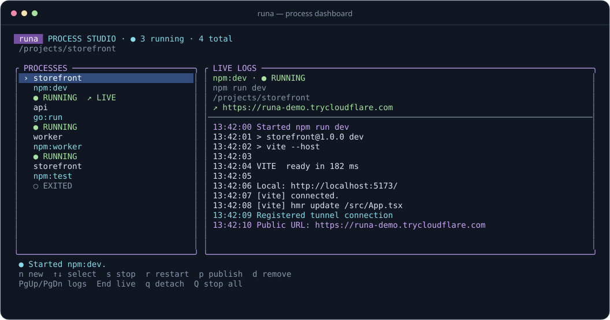

# runa

[](https://github.com/itIsMaku/runa/actions/workflows/ci.yml)

**Your projects, one terminal.** Discover how to run a project, manage its processes, watch live logs, and share localhost with a public URL. Works on macOS, Linux, and Windows.



_Example dashboard with demo projects and logs, rendered by runa's actual TUI. The preview URL is illustrative._

[Install](#install-locally) · [Dashboard](#process-dashboard) · [Agent commands](#agent-control-codex-claude-and-scripts) · [Supported projects](#detection)

```sh
cd my-project
runa                         # Open the dashboard; press n to detect and start a task
```

- **Detect the command.** Discover tasks from package.json, Make, Compose, Python, Rust, Go, .NET, or your own configuration.
- **Keep an overview.** Switch between projects and their logs, stop or restart a process, and reconnect after closing the dashboard.
- **Share a preview.** Publish an existing app through a temporary Cloudflare URL, then stop sharing while keeping the app running.
- **Let agents do the work.** Codex, Claude, and scripts can start tasks, read logs, and control the same processes through the JSON CLI while you watch the TUI.

Both `runa` and `runany` work. Use direct commands for foreground tasks and the agent CLI for automation:

```sh
runa --run                   # Detect and run the default task in the foreground
runa test                    # Run a named task
runa --list                  # Discover available tasks
runa --dry-run               # Preview the command
runa -- --port 3000           # Forward arguments to the default task
runa make:dev                # Select a specific runner
runa --choose                # Pick a task interactively
runa -C ../another-project    # Open the dashboard in a different directory
runa --publish               # Start the default app and share it through a public URL
runa agent start --wait-ready # Start a managed HTTP app; return its ID and status as JSON
runa agent logs PROCESS_ID   # Read a managed process's logs as JSON
```

## Install locally

Requires Node.js 20+ and npm:

```sh
git clone https://github.com/itIsMaku/runa.git
cd runa
npm ci
npm install --global .
runa
```

Or try it without installing:

```sh
node /path/to/runa/dist/bin.js -C /path/to/your-project --dry-run
```

The package is named `runanything-cli` locally; it has not been published to npm by this project. Use the repository installation above. The CLI is designed for macOS, Linux, and Windows. GitHub Actions checks all three systems with Node.js 20, 22, and 24.

## Process dashboard

Run `runa` in an interactive terminal to open the dashboard. It shows managed processes on the left and live logs for the selected process on the right, with colored status indicators and a public URL when sharing is enabled. Narrow terminals use a stacked layout.

| Key                    | Action                                                        |
| ---------------------- | ------------------------------------------------------------- |
| `n`                    | Detect tasks in the current directory and choose one to start |
| `↑` / `↓`              | Select a process and switch its log view                      |
| `s`                    | Stop the selected process and its tunnel                      |
| `r`                    | Restart the selected process                                  |
| `p`                    | Start or stop sharing the selected running app                |
| `d`                    | Remove a stopped process from history                         |
| `PgUp` / `PgDn`, `End` | Browse scrollback or return to live logs                      |
| `q`, Esc, Ctrl+C       | Detach, keeping managed apps and tunnels running              |
| `Q`, then `y`          | Stop all managed apps and tunnels and close the dashboard     |

Processes started from the dashboard or `runa agent start` belong to a background manager shared by your terminals. Close the dashboard, change to another project, and run `runa` again to see the same processes and logs. Pressing `n` always discovers tasks in the directory where that dashboard was opened. Task environments are captured from the terminal that starts them. Logs and process history are bounded and kept in memory for the manager's lifetime; there is no automatic reboot recovery or task restart.

Publishing an existing process does not restart its app. If a loopback URL was detected in its logs, `p` uses that origin; otherwise it asks for the app's port. A missing `cloudflared` keeps the installation confirmation flow, temporarily handing the terminal to the installer. Turning off sharing leaves the app running. Closing the dashboard leaves public tunnels running too; use `p`, `s`, `Q`, or `runa --shutdown` to stop them.

Direct commands such as `runa test`, `runa --run`, and `runa --publish` remain foreground commands and are not adopted into the dashboard. In non-interactive environments, bare `runa` keeps its previous foreground behavior. `runa --tui` explicitly requests the dashboard and requires a terminal. Input in managed tasks belongs to the dashboard; use foreground commands for applications that require interactive stdin. Keep managed servers in the foreground instead of daemonizing themselves.

```sh
runa --tui -C ../my-project
runa --run
runa --shutdown
```

The manager exits after a minute with no active tasks or clients. `runa --shutdown` stops its tasks and removes its discovery files. State lives under the user's application state directory; `RUNA_STATE_DIR` can override it for isolated sessions and tests. The manager listens only on loopback and authenticates local requests with a private token.

## Agent control (Codex, Claude, and scripts)

Use `runa agent …` to control the same background manager as the dashboard. An agent can start tasks while you watch their status, logs, and public URLs in `runa`; either client can stop or restart them. Agent commands work without a terminal, never open the dashboard, and never ask questions or install tools.

```sh
runa agent capabilities                         # Machine-readable commands and options
runa agent discover -C ../my-project             # Discover task IDs without running anything
runa agent start npm:dev -C ../my-project --wait-ready
runa agent list                                 # Read IDs and status of managed processes
runa agent inspect PROCESS_ID
runa agent logs PROCESS_ID --tail 100
runa agent logs PROCESS_ID --after 42             # Resume from nextCursor
runa agent logs PROCESS_ID --follow --timeout 5000
runa agent wait PROCESS_ID --for ready --timeout 30000
runa agent publish PROCESS_ID                    # Share this app and return its public URL
runa agent unpublish PROCESS_ID                  # Keep the app running
runa agent restart PROCESS_ID --wait-ready
runa agent stop PROCESS_ID
runa agent remove PROCESS_ID                     # Remove stopped history
```

Omit the task in `start` to use the detected default. Ambiguous projects return an error with task IDs to choose from. Forward application arguments after `--`, for example `runa agent start npm:dev -- --port 3000`. `list -C directory` filters the list to that project. Each successful start creates a new managed process; reuse the returned ID for subsequent commands. IDs survive restarts within the manager's lifetime. Agents and dashboards share the same OS user and `RUNA_STATE_DIR`; different state directories create independent managers.

JSON is the default (`--json` is also accepted). Each response has an API version and a success or error envelope:

```json
{ "version": 1, "ok": true, "result": { "id": "process-uuid", "status": "running" } }
```

```json
{
  "version": 1,
  "ok": false,
  "error": { "code": "NOT_FOUND", "message": "Process no longer exists." }
}
```

`capabilities` describes supported commands, flags, and wait conditions. `discover`, `capabilities`, and an empty `list` do not start a manager or execute project commands. `--help` prints human-readable help. Process output stays in the log buffer, keeping command stdout parseable. Inspect/list results include task, working directory, status, exit code when available, and local/public URLs; captured environment variables are omitted.

`logs` returns completed lines with sequence numbers and `nextCursor`. Use `--after nextCursor` to read new lines; `--tail` is the page limit (1–1000, default 100). Without a cursor it returns the latest lines. With a cursor it reads forward; keep fetching while `hasMore` is true. Partial lines appear separately in `pending` and do not advance the cursor until completed. `truncated: true` means older lines were evicted from bounded history. Log cursors survive process restarts but belong to one process ID and manager session. `logs --follow` emits NDJSON `logs` events and a final `end` event when the process exits or the follow timeout expires; a follow timeout is a successful bounded read.

`start --wait-ready`, `restart --wait-ready`, and `wait --for ready` wait for an HTTP response from the detected loopback origin. Any HTTP status counts as ready; this checks responsiveness, not application health. For apps that do not print a URL, use `wait --for ready --port 3000`. For workers or non-HTTP tasks, use `wait --for running` or `wait --for exited`. The latter returns the process's actual `exitCode`, including nonzero codes, in a successful query response. Waiting for readiness after a process exits returns `PROCESS_EXITED`.

Waits default to 30 seconds; `--timeout` accepts milliseconds up to 300000 on start, restart, wait, publish, and logs. Errors exit 1, timeouts exit 124, and interruptions exit 130. A timed-out readiness wait includes the process in `error.details.process`, so an agent can inspect or stop it. Timeout or interruption ends the client command and leaves managed apps and tunnels running. If a start was interrupted before its response, use `list` to recover its ID. `shutdown` stops **all** managed processes, including those started by other clients.

`publish` attaches to an existing app and waits for a public URL; `--no-wait` returns while connecting and `wait --for published` waits separately. `--port` selects an explicit local target. Missing `cloudflared` returns `DEPENDENCY_UNAVAILABLE` with installation instructions. Install it separately or use the dashboard's interactive installation flow. Publishing makes the app available to anyone with its public URL; it does not restart the app. Unpublishing leaves the app running.

If an older manager is still running after an upgrade, commands return `DAEMON_UPGRADE_REQUIRED` instead of replacing it and stopping its apps. At a convenient time run `runa --shutdown`, then reopen `runa` or start a managed task.

This repository includes operator instructions in [AGENTS.md](AGENTS.md) and a [CLAUDE.md](CLAUDE.md) entry point. For another project, add a short instruction to its agent instructions: “Use `runa agent discover/start/logs/stop` for managed tasks; preserve unrelated processes and use the returned process IDs.” No model-specific SDK or server setup is required.

## Detection

| Project files                                                              | Available tasks                                                       |
| -------------------------------------------------------------------------- | --------------------------------------------------------------------- |
| `package.json`                                                             | Nonempty scripts, using npm, pnpm, Yarn, or Bun                       |
| `GNUmakefile`, `makefile`, `Makefile`                                      | Static targets, including custom names                                |
| `compose.yaml`, `compose.yml`, `docker-compose.yaml`, `docker-compose.yml` | `up`, `down`, `logs`                                                  |
| `manage.py`                                                                | Django `dev` (`runserver`) and `test`                                 |
| `main.py`, `app.py`                                                        | Python `run`                                                          |
| `Cargo.toml`                                                               | `test`, `build`, `check`; `run` when a binary entry point is detected |
| `go.mod`                                                                   | `test`, `build`; `run` when the root has a `package main` Go file     |
| `*.csproj`, `*.fsproj`                                                     | Per-project build/test; run for executable and web projects           |
| `.runany.json`                                                             | Your own commands for any other project                               |

Node package managers are selected from `packageManager` first, then lockfiles (pnpm, Yarn, Bun, npm), otherwise npm. Python uses `.venv` when present, otherwise `python3` on Unix or `py -3` on Windows.

Discovery reads files without evaluating them or running tools. It only considers the selected directory. Make discovery is intentionally limited to static targets: includes, generated targets, and Make expressions are not evaluated. Cargo workspaces, Go apps under `cmd/`, custom Python layouts, and other unsupported layouts can use explicit configuration.

## Default selection

An explicit configured default wins. Otherwise runany prefers configured tasks, package scripts, Make targets, Compose, then language tools. Within each group it prefers `dev`, `start`, `serve`, `run`, `up`, then `watch`. Build and test are never chosen automatically.

If there is no clear default, an interactive terminal asks for a task. Non-interactive usage fails with an instruction to list and choose a task. If multiple runners define `test`, use an ID such as `npm:test` or `make:test`. An explicitly configured command overrides other tasks with the same short name.

Every execution prints the selected command. Standard input, output, and error pass through to the task; its exit code is preserved. Arguments after `--` are forwarded to the selected task. For npm and Cargo run/test, runany inserts the runner's required `--` separator. Use configuration when you need to pass options to the runner itself.

## Custom projects

Create `.runany.json` in the project:

```json
{
  "default": "dev",
  "commands": {
    "dev": ["python3", "tools/server.py"],
    "test": ["python3", "-m", "pytest"],
    "worker": ["docker", "compose", "up", "worker"]
  }
}
```

Commands are arrays of executable and arguments, so paths with spaces work. They execute in the project directory. Shell operators such as `&&` are not interpreted in configuration; invoke a script or an explicit shell if needed. Use platform-compatible executables for shared cross-platform configuration.

runany does not install project dependencies or missing runners itself. The chosen runner keeps its normal behavior, including any restores/builds and dependency downloads performed by tools such as Cargo, Go, Docker, or .NET. Run tasks only in projects you trust, just as with `npm run` or `make`.

## Machine-readable discovery

```sh
runa --list --json
runa test --dry-run --json
```

## Share a localhost preview

In a web project:

```sh
runa --publish
```

If `cloudflared` is missing, an interactive terminal offers to install it and shows the exact command first, for example `brew install cloudflared` on macOS. Answer `y` to install, verify the tool, and continue sharing in the same invocation. Answer `n`, press Enter, or press Ctrl+C to cancel before the app starts. Homebrew is supported on macOS/Linux when already installed; Windows uses WinGet when available. The package manager's own prompts and progress remain visible. If no supported manager is available, install [cloudflared manually](https://developers.cloudflare.com/tunnel/downloads/).

Non-interactive commands and dry runs never install or wait for consent. A failed installation or failed verification stops before the app starts; an installed tool with a failing version check is reported without offering a reinstall.

runany starts the selected task, detects a loopback URL from its startup output, waits for an HTTP response, and starts a [Cloudflare Quick Tunnel](https://developers.cloudflare.com/tunnel/get-started/quick-tunnels/). The terminal prints a temporary HTTPS URL such as `https://random-name.trycloudflare.com` to share with a friend. A Cloudflare account or domain is not required. Anyone with that URL can access the app; Ctrl+C stops the app and tunnel. The URL changes on the next run.

If the app doesn't print a local URL, specify its port:

```sh
runa --publish --port 3000
runa dev --publish --port 3000 -- --port 3000
runa --publish --port 3000 --dry-run
runa --publish --port 3000 --dry-run --json
```

`--port` sets the tunnel's local target; it does not change the app's listening port. Forward application-specific flags after `--` when needed. Explicit ports already in use are rejected before the task starts. Automatic detection accepts complete HTTP/HTTPS URLs on `localhost`, `127.0.0.1`, `0.0.0.0`, `[::1]`, or `[::]`; wildcard listeners are mapped to loopback. It does not scan other ports. HTTPS origins must have a certificate trusted by Node.js and cloudflared.

Startup discovery/readiness has a 60-second limit; the tunnel has 30 seconds to provide a public URL. If the app exits, the tunnel fails, or startup times out, both process trees are stopped. The app's nonzero exit code is preserved. Application output remains visible, but publish mode captures it through pipes, so buffered output or TTY-dependent tools may need an explicit port or unbuffered logging. Keep the task in the foreground rather than daemonizing its server.

This shares one local web service for a preview. Frontends with separate APIs should proxy those requests through the shared app instead of using browser URLs pointing to `localhost`. Some frameworks also need trusted-origin settings; runany forwards the local Host header but does not edit project configuration. Quick Tunnels have no uptime guarantee and do not support Server-Sent Events; see the [provider's limits](https://developers.cloudflare.com/tunnel/get-started/quick-tunnels/#limitations).

The default provider is `cloudflare` (`--tunnel cloudflare`). Providers are separate modules; no runner-specific publishing logic or extra npm runtime dependency is required.

## Development

Source code uses strict TypeScript and compiles to ESM JavaScript in `dist/`. The installed CLI has no runtime dependencies and does not need TypeScript. Biome handles linting, import ordering, and formatting; CI checks these alongside types, tests, and installation of the packaged CLI.

```sh
npm ci
npm run lint
npm run check
npm test
npm run test:package
npm run format         # Format source, tests, and JSON
npm run lint:fix       # Apply safe lint fixes and organize imports
```

Runner modules live in `src/runners/`; Node package managers live in `src/package-managers/`. Each implements a small typed interface and is registered in its directory's `index.ts`. Selection and process execution use task metadata, so new integrations do not require runner-specific changes to the core. See [the extension guide](CONTRIBUTING.md#adding-a-runner) for an example.

Contributions and bug reports are welcome. See [CONTRIBUTING.md](CONTRIBUTING.md) or [open an issue](https://github.com/itIsMaku/runa/issues).

Licensed under [MIT](LICENSE).
